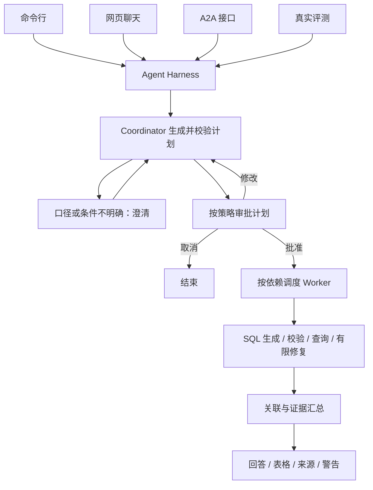

# 多数据源查询 Agent 与运行评测 Harness

[English](README.md) | **简体中文**

基于 LangGraph 的自然语言查询系统。用户通过对话查询销售、商品、库存、人力资源、酒店经营和金融交易数据；系统完成任务规划、业务口径澄清、人工审批、SQL 生成与校验，并汇总各数据源的查询证据。

项目默认使用 DeepSeek，可配置 Azure OpenAI。Agent Harness 为命令行、网页、A2A 和真实评测提供统一的预算、超时、权限策略和运行追踪。

## 核心功能

- **多 Agent 协作**：Coordinator 生成有界任务依赖图，各 Worker 查询自己的数据源；独立任务并行，有依赖的任务传递结构化证据。
- **业务口径与多轮上下文**：指标字典描述公式、粒度、别名、单位和时间字段；保存条件来源及审批状态，支持追问继承和新话题重置。
- **人工参与**：查询计划支持批准、修改和取消，暂停后通过检查点恢复。
- **SQL 生成与执行**：结合实际 Schema、数据源方言和业务上下文生成 SQL，通过校验后执行，失败时有限修复。
- **跨源结果关联**：按明确的共享键执行确定性关联，拒绝重复键、空键及不完整结果，不猜测实体映射。
- **统一 Harness**：限制模型调用、工具调用、任务数、并发和重试；管理请求、模型和任务超时，记录 Trace 与用量。
- **数据访问控制**：数据源允许列表、字段限制、结果脱敏和行数上限；默认阻止模型生成代码在宿主机执行。
- **多用户网页**：账号注册、密码哈希、恢复码、会话撤销、数据源授权以及个人聊天和检查点隔离。
- **评测与回归**：固定题集、确定性结果断言、可选答案 Judge、JSON/HTML 报告、基线比较和质量门禁。
- **多入口**：CLI、Chainlit Web UI、A2A 服务及 Python 调用。

## 架构与执行流程



父 Workflow 的节点和跳转由代码定义，任务数量、执行 Agent 和依赖关系由模型动态规划。当前 Worker 是同一应用中的 LangGraph 子图，不是独立部署的远程服务；A2A 是系统对外提供的协议入口。

主要实现：

| 模块 | 代码 |
|---|---|
| 父工作流和 Agent 初始化 | [agent.py](src/data_agent/agent.py) |
| 规划、审批、调度和汇总 | [collaboration.py](src/data_agent/collaboration.py) |
| Worker 查询子图 | [graph.py](src/data_agent/graph.py) |
| Schema、指标与条件管理 | [context.py](src/data_agent/context.py) |
| 统一运行入口 | [runtime.py](src/data_agent/harness/runtime.py) |
| 评测与报告 | [evaluation](src/data_agent/evaluation/) |

## 数据源与业务场景

| 配置 | Agent | 业务数据 | 远端数据源 |
|---|---|---|---|
| contoso | contoso_sales | 客户、订单 | Databricks SQL |
| contoso | contoso_products | 商品目录 | Azure Cosmos DB |
| contoso | contoso_inventory | 仓库、库存、发货 | PostgreSQL |
| adventure_works | contoso_hr | 部门、员工、绩效、休假 | Azure SQL |
| adventure_works | hotel_analytics | 酒店经营数据 | Azure Synapse |
| amex | financial_transactions | 账户、交易、欺诈告警 | Google BigQuery |

远端查询使用对应方言。本地样例模式将六份 JSON 分别加载到独立的内存 SQLite 数据库，共 21 张表、720 条记录，使用 SQLite 语法。样例测试不代表六类云数据库均已完成真实集成验证。

## 快速开始

需要 Python 3.12+、uv，以及有效的模型访问凭据。以下命令在项目根目录运行。

### 安装

```powershell
git clone https://github.com/1917691934wjp-del/agent-data-harness.git
cd agent-data-harness
uv sync --all-extras
Copy-Item .env.example .env
```

编辑 `.env`，配置模型凭据，并启用本地样例模式：

```dotenv
DEEPSEEK_API_KEY=your-api-key
DEEPSEEK_BASE_URL=https://api.deepseek.com
DEEPSEEK_MODEL=deepseek-flash
DATA_AGENT_SAMPLE_MODE=true
DATA_AGENT_SAMPLE_DIR=scripts/data
```

具体模型也由 YAML 中的 `llm.model` 决定，环境变量中的 `DEEPSEEK_MODEL` 是模型名未配置时的回退值。连接远端数据库时关闭样例模式，并按 [数据库配置](docs/DATABASE_SETUP.md) 设置连接参数。

### 命令行

```powershell
uv run data-agent configs
uv run data-agent validate contoso
uv run data-agent query "统计库存记录数" -c contoso -v
uv run data-agent query "分别统计订单数和库存记录数，不做关联" -c contoso -v
uv run data-agent chat -c contoso
```

跨源查询按默认策略需要确认。库存不足等含糊口径可能先要求澄清，不能把暂停理解为查询失败。

### 网页聊天

```powershell
uv run python scripts/setup_history.py
uv run data-agent-ui
```

访问 `http://localhost:8000`。初始化脚本交互设置管理员密码，并生成签名密钥；新注册用户默认没有数据源权限。授权和恢复流程见 [多用户说明](docs/MULTI_USER.md)。

### A2A 服务

```powershell
uv run data-agent a2a --config contoso
```

Agent Card：`http://localhost:8001/.well-known/agent-card.json`。接口和客户端示例见 [A2A 文档](docs/A2A.md)。

### Python 调用

```python
import asyncio
from data_agent import DataAgentFlow
from data_agent.harness import AgentHarness

async def main():
    async with DataAgentFlow(
        config_path="src/data_agent/config/contoso.yaml"
    ) as flow:
        result = await AgentHarness(flow).run_output("统计库存记录数")
        print(result.get("final_response"))
        print(result.get("harness"))

asyncio.run(main())
```

## 业务指标配置

内置目录包含库存量、库存记录数、低库存记录数、低库存产品数、订单数、订单金额、当前在职人数及可用库存定义。系统按实际字段检查可用性；例如缺少占用量字段时，不能用实物库存代替可用库存。

通过环境变量指定人工审阅的 JSON 指标目录：

```dotenv
DATA_AGENT_METRICS_FILE=evals/business_metrics.example.json
```

自定义目录整体替换默认目录，模板见 [business_metrics.example.json](evals/business_metrics.example.json)。公式是口径描述，不是直接执行的 SQL 模板。详见 [业务语义框架](docs/BUSINESS_SEMANTICS.md)。

## 评测与验证

### 离线回放

```powershell
uv run data-agent eval run evals/sample/suite.json --observations evals/sample/demo_observations.json --output outputs/evaluations/demo-001
```

打开生成的 `report.html` 查看差异。演示刻意包含 5 个错误，预期 25/30 通过，退出码为 1；这是评分演示，不是模型准确率。每次使用新输出目录。

### 真实模型评测

在已配置凭据并启用样例模式的情况下运行：

```powershell
uv run data-agent eval run evals/sample/suite.json --mode live --config all --allow-approvals --review-policy cross_source --timeout 120 --output outputs/evaluations/live-001
```

真实评测会调用模型并消耗额度。审批按题集中显式写出的步骤执行，不会自动批准任意计划。

### 相关测试

```powershell
uv run python -m pytest tests/test_business_metrics.py tests/test_context.py tests/test_collaboration.py tests/test_human_review.py -o addopts='' -p no:cacheprovider -q
```

业务指标扩展后的这组离线回归共 79 项，通过。项目此前记录的一轮 30 题 DeepSeek 真实评测通过 29 题（96.7%），P95 案例耗时 5.43 秒；该结果针对当时版本、固定本地数据和交互策略，不代表当前全部改动或生产环境表现。另有 200 案例题集，详见 [场景基准](evals/benchmark200/README.md)。

## 实现边界

- 尚未实现向量数据库 RAG、豆包接入或大小模型自动升级流程。
- 业务歧义识别和 SQL 口径理解仍依赖模型与评测，没有通用 SQL 语义等价证明。
- 跨源关联需要明确且同义的键；样例商品 ID 存在格式差异，不能自动推断映射。
- 异步超时不能保证数据库服务端查询立刻停止，需要驱动与服务端超时配合。
- Token 和费用在模型返回后结算，最后一次调用或已开始的并发调用可能超额。
- 多用户功能提供数据源和个人历史隔离，不自动提供业务数据库的行级租户隔离。
- 多任务图表生成关闭；单任务可视化需满足执行器及 Harness 策略要求。

## 详细文档

- [配置说明](docs/CONFIGURATION.md)
- [本地样例数据](docs/LOCAL_SAMPLE_DATA.md)
- [多 Agent 协作](docs/MULTI_AGENT.md)
- [人工审批与恢复](docs/HUMAN_IN_THE_LOOP.md)
- [上下文与口径](docs/CONTEXT.md)
- [业务指标框架](docs/BUSINESS_SEMANTICS.md)
- [Harness 策略与追踪](docs/HARNESS.md)
- [评测中心](docs/EVALUATION.md)
- [多用户与数据权限](docs/MULTI_USER.md)
- [聊天历史](docs/CHAT_HISTORY.md)

## 来源与许可证

本项目基于 [eosho/langchain_data_agent](https://github.com/eosho/langchain_data_agent) 扩展，增加多 Agent 协作、运行与评测 Harness、业务口径上下文及多用户功能。保留原作者版权声明，采用 [MIT 许可证](LICENSE)。
